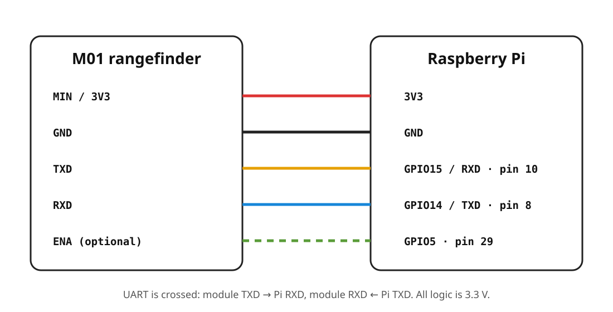

# M01 Laser Rangefinder for Raspberry Pi — UART + Bluetooth RFCOMM

[](https://github.com/Amirmobash/laser-m01-raspberrypi-bluetooth/actions/workflows/ci.yml)

A small Python driver and Bluetooth bridge for the **M01 6-pin laser distance/rangefinder module** on Raspberry Pi. It talks to the module over the Pi UART, decodes the M01 binary `0xAA` measurement frames, and can expose live distance readings over **Bluetooth Classic RFCOMM** as newline-delimited JSON.

**Deutsch:** [README.de.md](README.de.md)

This repository is intentionally narrow: one driver, one CLI, one RFCOMM server, tests, and a service file. There is no web framework and no abandoned Bluetooth Python wrapper in the runtime path.

## What it does

- Read one distance measurement from the M01 over UART.
- Stream measurements at a configurable rate.
- Switch the laser emitter on and off.
- Reset the module through `ENA` when that pin is connected to a Raspberry Pi GPIO.
- Serve measurements to a paired Bluetooth client over RFCOMM channel 1 (configurable).
- Emit stable JSON that is easy to consume from Android, Linux, a laptop, or another embedded computer.
- Run as a systemd service without assuming that the Raspberry Pi username is `pi`.

## Hardware and wiring

The driver uses **3.3 V logic**. UART lines must be crossed.



| M01 signal | Raspberry Pi | Header pin | Notes |
|---|---|---:|---|
| `MIN / 3V3` | `3V3` | 1 or 17 | Verify the power requirement of your module revision. |
| `GND` | `GND` | e.g. 6 | Common ground is mandatory. |
| `TXD` | `GPIO15 / RXD` | 10 | Module TX goes to Pi RX. |
| `RXD` | `GPIO14 / TXD` | 8 | Module RX goes to Pi TX. |
| `ENA` | `GPIO5` | 29 | Optional. Use it only if ENA is available on your harness. |

The reference module harness was documented with red = 3.3 V, black = GND, yellow = TXD and green = RXD. **Do not trust wire colours blindly**; module revisions and vendor harnesses can differ.

If the M01 becomes unstable when powered from the Pi 3.3 V rail, use a properly regulated external 3.3 V supply and keep the grounds common.

## Raspberry Pi UART setup

On Raspberry Pi OS, enable the hardware serial port and disable the login shell on it:

```bash
sudo raspi-config
```

Choose the serial interface settings, answer **No** to a login shell over serial, and **Yes** to enabling the serial hardware. Reboot afterwards.

The project defaults to `/dev/serial0`, which is the preferred Raspberry Pi alias for the primary UART.

Add your account to `dialout` so it can open the serial device without running the application as root:

```bash
sudo usermod -aG dialout "$USER"
```

Log out and back in after changing groups.

## Install

Target: Raspberry Pi OS Bookworm or newer, Python 3.11+.

```bash
sudo apt update
sudo apt install -y python3-venv bluez

git clone https://github.com/Amirmobash/laser-m01-raspberrypi-bluetooth.git
cd laser-m01-raspberrypi-bluetooth

python3 -m venv .venv
source .venv/bin/activate
python -m pip install --upgrade pip
pip install -e .
```

If you connected `ENA` to a GPIO and want software reset support:

```bash
pip install -e ".[gpio]"
```

## First measurement

The common baud rate for this module is 9600. Some units are configured differently, so 115200 is worth trying if you receive no valid frames.

```bash
m01 measure
```

Example:

```text
1.534 m (1534 mm)
```

JSON output:

```bash
m01 measure --json
```

Use another serial port or baud rate if needed:

```bash
m01 measure --port /dev/ttyAMA0 --baud 115200
```

## CLI

```bash
# One measurement; laser is switched off again when the command finishes
m01 measure

# Continuous output
m01 stream --hz 5

# Newline-delimited JSON
m01 stream --hz 10 --json

# Direct emitter control
m01 laser on
m01 laser off

# Hardware reset through ENA on BCM GPIO 5
m01 reset --ena-gpio 5

# Bluetooth RFCOMM bridge
m01 rfcomm-server --channel 1 --hz 5
```

The same settings can be supplied through environment variables:

```text
M01_PORT=/dev/serial0
M01_BAUD=9600
M01_ENA_GPIO=-1
M01_RFCOMM_CHANNEL=1
M01_HZ=5
```

`M01_ENA_GPIO=-1` means ENA is not controlled by software.

## Bluetooth protocol

The RFCOMM server accepts simple single-character commands, which makes it usable from generic serial-terminal clients:

| Command | Action |
|---|---|
| `Q` | Take one measurement. |
| `S` | Start streaming. |
| `P` | Pause streaming. |
| `L` | Laser on. |
| `K` | Laser off. |
| `R` | Reset through ENA. |
| `H` | Return command help. |

Messages from the server are one JSON object per line:

```json
{"type":"measurement","meters":1.534,"millimeters":1534,"timestamp":"2026-10-23T16:10:12.421Z"}
```

### Bluetooth pairing and SPP discovery

Pair and trust the client using BlueZ:

```bash
bluetoothctl
power on
agent on
default-agent
pairable on
discoverable on
```

After pairing, the Python server listens directly on the configured RFCOMM channel. Some serial-terminal applications also expect an SDP **Serial Port** record. On systems where local SDP registration is enabled, you can add one with:

```bash
sudo sdptool add --channel=1 SP
```

BlueZ configurations differ. If local `sdptool add` is disabled, do not weaken the system configuration just to satisfy this project; use a client that can connect to the known RFCOMM channel or configure SDP deliberately for your deployment.

**iPhone/iPad note:** normal iOS applications do not expose generic Bluetooth Classic SPP in the same way Android/Linux clients do. A BLE GATT transport or Apple MFi accessory path is a separate implementation and is not pretended to be part of this repository.

A minimal Linux client is included:

```bash
python clients/rfcomm_client.py AA:BB:CC:DD:EE:FF --command S
```

## Run on boot

For a fixed installation, use the provided installer:

```bash
sudo ./scripts/install.sh
```

It installs the project to `/opt/m01-bridge`, creates a virtual environment, installs the systemd template, and adds the invoking user to `dialout`. It does **not** enable the service before you review the settings.

Edit:

```bash
sudo nano /etc/default/m01-bridge
```

Then enable the service for your actual Raspberry Pi username:

```bash
sudo systemctl enable --now m01-bridge@$USER.service
sudo systemctl status m01-bridge@$USER.service
```

Logs:

```bash
journalctl -u m01-bridge@$USER.service -f
```

## M01 binary protocol used here

This implementation follows the working ESP32 reference by [Andres-ros/laser-m01-esp32](https://github.com/Andres-ros/laser-m01-esp32). The M01 is **not** controlled here by sending ASCII `Q`, `L`, `K`, or `R` to its UART. Those letters are only the human-facing commands used by the CLI/RFCOMM interface.

The module commands are binary frames:

```text
Laser on:      AA 00 01 BE 00 01 00 01 C1
Laser off:     AA 00 01 BE 00 01 00 00 C0
Quick measure: AA 00 00 22 00 01 00 00 23
Read result:   AA 80 00 22 A2
```

A measurement response is expected as a 13-byte frame beginning with `0xAA`. The parser validates the checksum, accepts measurement function bytes `0x20`, `0x21` or `0x22`, decodes four BCD distance bytes, and resynchronizes if noise or a damaged frame appears on the UART.

## Troubleshooting

**No data from the module**

- Confirm module `TXD → GPIO15/RXD` and module `RXD ← GPIO14/TXD`.
- Confirm a common ground.
- Confirm ENA is high if your board exposes it.
- Try both `--baud 9600` and `--baud 115200`.
- Make sure the serial login console is disabled.

**Permission denied on `/dev/serial0`**

```bash
sudo usermod -aG dialout "$USER"
```

Then log out and back in.

**Bluetooth server starts but a phone does not list an SPP service**

Pair the devices first, check that `bluetooth.service` is running, and read the SPP discovery note above. RFCOMM transport and SDP service discovery are related but separate pieces of BlueZ.

**Reset says ENA is unavailable**

That is intentional. The driver will not invent an undocumented UART reset command. Connect ENA to a GPIO and install the `gpio` extra, or power-cycle the sensor manually.

## Tests

Protocol parsing is hardware-independent and covered by tests, including checksum failure, invalid BCD data, noisy UART input and fallback read behavior.

```bash
pip install -e ".[dev]"
pytest
ruff check .
```

## Safety

The module is a laser rangefinder and may use an infrared emitter that is difficult or impossible to see. Follow the safety classification and operating instructions for your exact module. Do not aim it at eyes or nearby reflective surfaces.

## Credits and license

The M01 binary command frames and working ESP32 behavior were derived from the MIT-licensed reference project [Andres-ros/laser-m01-esp32](https://github.com/Andres-ros/laser-m01-esp32). This Raspberry Pi implementation is independently structured for Python, BlueZ and Linux service operation.

Released under the [MIT License](LICENSE).
